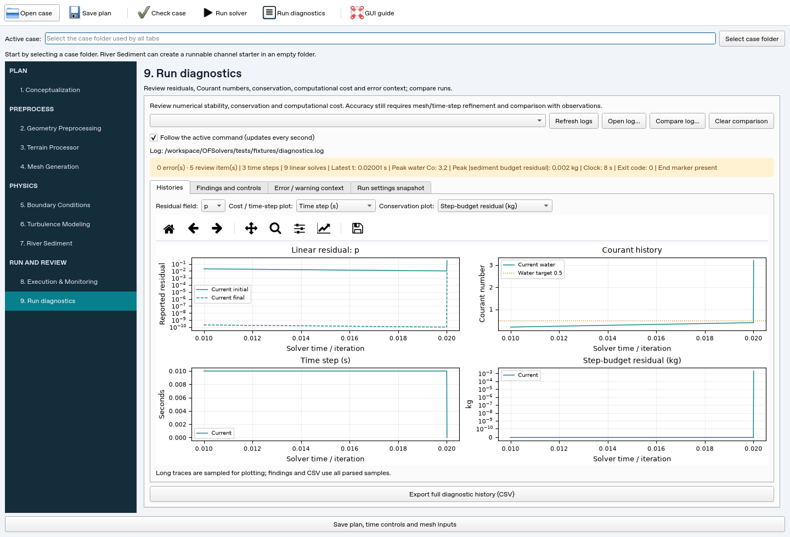

# OFSolvers GUI — river setup and numerical QAQC

[Repository home](README.md) · [Detailed case setup](docs/gui-user-guide.md) ·
[Synthetic river designer](docs/river-design.md) ·
[Solver installation](docs/getting-started.md) ·
[Concentration solver](docs/sedimentPimpleFoam.md) · [Sand parcels](docs/sandParcelPimpleFoam.md)

The workbench prepares OpenFOAM river cases and helps investigate whether a run
is behaving numerically as intended. Its post-processing is **run diagnostics**:
residuals, Courant limits, time-step behavior, computational cost, sediment
conservation and error context. Continue using **ParaView** for water levels,
velocity/concentration fields, bed maps and particle visualization.

## Installation and launch

Requirements: Python **3.10+**, PyQt6, NumPy, Matplotlib, PyVista and PyVistaQt.
Install the tested dependency ranges from the repository root:

```bash
python3 -m venv .venv
source .venv/bin/activate
python -m pip install -r requirements-gui.txt
python main.py
```

For DEM/GeoTIFF conversion, additionally install:

```bash
python -m pip install -r requirements-terrain.txt
```

On Windows, the equivalent Python commands in PowerShell are:

```powershell
py -3 -m venv .venv
.\.venv\Scripts\python.exe -m pip install -r requirements-gui.txt
.\.venv\Scripts\python.exe main.py
```

Preprocessing and log analysis do not need OpenFOAM. The GUI launches utilities
and solvers **on the machine running the GUI**; it does not connect to WSL, SSH
or a cluster automatically. For native execution, run the GUI in the activated
Linux/WSL OpenCFD v1912 environment, with a desktop display and both custom
solvers built as described in [Getting started](docs/getting-started.md).
Windows desktop launch and remote-display configurations need local testing;
automated GUI checks run with Linux/offscreen Qt. An offscreen test platform
is not an interactive desktop service.

## Workflow and case folder

Use **Open case** / **Select case folder** to choose an existing folder. The
active path is shared by all case-writing and execution stages. Keep run folders
outside the source checkout. The left sidebar follows the case workflow:

| Stage | Purpose |
| --- | --- |
| 1. Conceptualization | Domain size/resolution, boundary plan, times, Courant time-step and Froude estimates |
| 2. Geometry Preprocessing | Design synthetic river terrain, obstacles, rough-wall meshes and boundaries; import/transform existing geometry |
| 3. Terrain Processor | Convert projected terrain rasters to local model surfaces |
| 4. Mesh Generation | Background mesh and snappyHexMesh dictionaries, geometry inspection |
| 5. Boundary Conditions | Edit water-flow boundaries using actual mesh patch names |
| 6. Turbulence Modeling | Laminar/RAS/LES configuration and supporting fields |
| 7. River Sediment | Concentration/finite-bed or parcel/resuspension properties and initial fields |
| 8. Execution & Monitoring | Mesh generation, file checks, native mesh QAQC, serial/MPI runs and reconstruction |
| 9. Run diagnostics | Live/saved-log histories, comparison, findings, error context and run settings |

Toolbar actions provide **Open case**, **Save plan**, **Check case**, **Run
solver**, **Run diagnostics** and **GUI guide**. `Ctrl+O` opens a case;
`Ctrl+S` saves the plan; `F1` opens this guide. Saving a plan does not run a
solver. The detailed setup guide explains which files each editor writes and
where backups are retained.

### Pixel wizard banner

The top of the workbench includes an original 1980s-style pixel wizard walking
past a forest, a red Corps-style three-tower castle and a snowy mountain. About
30% of crossings are uninterrupted walks; on the others he performs one random
trick. Tricks do not follow a fixed sequence, and consecutive performances use
different tricks. He reverses direction at each edge.

His eleven tricks include a spread-eagle hop, staff flame, an **ESSAYONS!** speech
balloon, a breakdance arm wave, a stumble, a pipe smoke ring, a lightning spell,
blowing a whistle as a dog runs past, a sneeze, a full cartwheel, and a
**Models are magic** thought bubble. The banner has its own random generator
and does not change simulation random seeds.

Use **Pause wizard / Resume wizard** in the banner to freeze or resume the scene.
The toolbar's **Wizard banner** toggle hides it to reclaim workspace. Animation
stops while hidden or paused and freezes while the window is minimized. It uses
Qt pixel drawing with a cached background and needs no image downloads or extra
packages. These controls remain available while a model runs.


[Watch/download the MP4 preview](docs/images/wizard-preview.mp4) ·
[Looping GIF preview](docs/images/wizard-preview.gif). This reproducible random
sample shows all eleven tricks and three quiet crossings, using the GUI's
animation code and normal timing at a 960-pixel banner width (about two minutes).

### Design a synthetic river case

In **Geometry Preprocessing → Synthetic river, mesh and boundaries**, define a
trapezoidal/rectangular channel, wall spacing and roughness, discharge/sediment
plan, and optional piers, rigid stems, boulders, bedforms or bank structures.
**Preview and analyze** shows design geometry and hydraulic/mesh review messages.
Create the case in an empty active folder, then **Build river mesh and run native
quality checks**. Successful fixed-domain meshing applies water, RANS and sediment
boundaries using the actual patches. A failed native check stops readiness.

Use **Export STL files…** for geometry alone. VOF mode exports water/air meshing
inputs for a separately completed native free-surface case. The
[river-design guide](docs/river-design.md) explains grading, mesh acceptance,
estimated versus measured y+, Q/C hydrographs, parcel feeds and model limits.

### First runnable tutorial sediment case

1. Select a new, empty case folder.
2. Open **River Sediment**, choose `sedimentPimpleFoam` or
   `sandParcelPimpleFoam`, and click **Create runnable starter case**.
3. Set water/sediment properties and inlet/bed choices, then validate/write
   sediment settings. These material controls do not write water-flow boundaries.
4. In **Execution**, generate the initial mesh. In **Boundary Conditions**,
   import the actual patches, edit the inlet discharge and review other patches.
5. Set time controls, save the plan, then **Check case and mesh**. Resolve
   reported errors and review warnings before running.
6. Start with one MPI rank and a short run. Open **Run diagnostics** during
   execution or after completion. Use ParaView for the saved fields.

Both sediment starters use a fixed water domain and fixed bed elevation with
dilute, one-way sediment transport. Selecting a native VOF solver does not
turn a sediment starter into a coupled free-surface/moving-bed model. Complete
VOF cases need their native phase fields and boundary conditions.

## Execution logs and run settings

Every GUI command receives a unique directory inside the active case:

```text
case/
  logs/
    20261016T120000-solver-<id>/
      console.log
      settings.json
```

Names use UTC. Mesh generation, mesh QAQC, decomposition, solver execution and
reconstruction get separate records. The console log includes the command,
working case, complete streamed output and exit/cancellation footer. Logging
is flushed as output arrives, so the on-disk log outlives the console's 10,000
line display limit. If the log cannot be created, the command is not launched.

`settings.json` captures the command, case, OpenFOAM version and available
numerical/material dictionaries **before that command starts**, including
`controlDict`, `fvSolution`, `fvSchemes`, decomposition and sediment/cloud
properties. The **Run settings snapshot** page displays these original values;
later case edits do not change the snapshot. This is not a complete restart
backup: mesh files and time-directory fields are not copied.

Case editing and case switching are disabled during execution; **Execution**
and the read-only **Run diagnostics** stage remain accessible. **Stop running
command** terminates the process group. A stopped run may have incomplete
output, so review restart fields before continuing. HPC submission and automatic
remote execution are not implemented.

## Run diagnostics



*Interface example using illustrative v1912-format log data; not a solver
validation run.*

### Live and existing logs

**Follow the active command** displays new diagnostic samples about once per
second while the page is visible. Native output remains in Execution as well.
**Open log…** accepts an existing solver/utility log anywhere. The log dropdown
finds root-level `log.*` files and GUI `logs/*/console.log` files in the active
case. Select a file to load it; **Refresh logs** updates the list and reloads a
selected historical log. Log parsing runs in a background thread.

**Compare log…** overlays a second run. Findings apply to the current run; the
comparison is visual context. Check its mesh, time interval, solver settings,
MPI ranks and hardware before interpreting a difference as an improvement.
**Clear comparison** removes it. Opening a historical log pauses live following;
re-enable the checkbox to receive output from subsequent active-command updates.

### Histories and their meaning

| Diagnostic | Interpretation |
| --- | --- |
| Initial/final residual for a selected field | Every linear solve is retained, including repeated PIMPLE corrections at the same time; not a nonlinear or physical-accuracy certificate |
| Water Courant number | Solver-reported mean/max; review against your stability target and chosen schemes |
| Interface Courant number | Kept separate from water Co when a native free-surface solver logs it |
| Sediment Courant number | Rebuilt concentration solver logs settling-inclusive mean/max after flow correction; older builds may omit it |
| `deltaT` | Printed time-step values; no missing value is inferred from mesh size or residuals |
| Wall time per step | Difference between successive `ClockTime` values in the same run segment; the first difference is unavailable and clock rounding can yield zero |
| Sediment step-budget residual | The concentration solver's discrete **per-step** residual in kg; not a cumulative loss or an outlet rate |
| Suspended/bed inventories | Concentration-solver stored masses in kg |
| Mobile/deposited inventories | Parcel-solver stored masses in kg; these alone do not close a mass balance |
| Minimum `C` | Concentration in kg/m³, useful for detecting significant undershoots |
| Cumulative continuity | Solver-reported flow-continuity diagnostic; not sediment mass or an inferred volumetric-flow error |

The parser follows the supplied v1912 log format, pairing pre-step Co/deltaT
with the following `Time` record; post-flow sediment Co belongs to the current
step. Repeated/backward times and recognized run
headers begin separate segments; plots do not connect restart histories across
those segments. Time is seconds for the transient sediment solvers; native
steady solvers may use iteration-like `Time` values.

Residual plots use a symmetric-log scale so reported zeros remain visible.
Long traces are sampled to bound rendering cost; **findings and exported CSV
use every parsed sample**. Missing values are shown as not logged, never as zero.
`ExecutionTime` is retained in CSV; it is not interpreted as aggregate MPI CPU
usage or efficiency.

### Findings, thresholds and debugging

The **Findings and controls** page provides evidence and specific places to
investigate. It detects fatal errors/nonfinite values, water-Co target
exceedances, more than 100× time-step variation, significant negative `C`,
step-budget tolerance exceedances and high final linear residuals at the latest
step. **Error / warning context** retains surrounding lines for dictionary
paths, boundary names, bounding warnings and stack messages.

Screening defaults are **water Co 0.5**, **final linear residual 1e-6** and
**absolute sediment step-budget tolerance 1e-10 kg**. These are editable review
thresholds, not universal solver acceptance criteria or automatic changes to
your case. The mass default matches small tutorial-scale checks; choose an
appropriate tolerance for the inventory and units of your river model. Negative
`C` is flagged below −1e-12 kg/m³. Review paths include:

- `system/controlDict`: `adjustTimeStep`, `maxCo`, `maxDeltaT`, `deltaT`.
- `system/fvSolution`: per-field `tolerance`/`relTol`, PIMPLE corrections.
- `system/fvSchemes`: transport and boundedness schemes.
- `constant/sedimentProperties`: settling and `maxSedimentCo`.
- Mesh quality and physical initial/boundary values when steps collapse or
  fields become nonfinite.

The tool never adjusts these numerical controls automatically. An `End` marker
and zero exit code indicate normal process termination, not an accurate river
solution. An early/incomplete log or unrecognized diagnostic remains unknown.
Parcel conservation additionally requires injection, escape and restart
inventories; the GUI does not fabricate closure from mobile/deposited totals.

### Accuracy and run comparisons

Use the workbench to establish stable, converged and conservative runs, then
compare successively finer meshes and smaller time steps at the same physical
conditions. Compare quantities that matter to the project—discharge, water
levels, velocities, sediment fluxes and concentrations—using ParaView/exported
data and observations. Keep run settings and logs for each refinement. A tighter
linear tolerance or a smoother residual curve alone does not establish accuracy.

**Export full diagnostic history (CSV)** writes separate `step` and
`linearResidual` records, including segment/time, iteration count, Co, clock
values, continuity errors and available sediment quantities. Blank entries mean
not logged; mass fields/rates carry explicit unit suffixes. Continuity values
are solver-reported diagnostics, not sediment kg. The source log and settings
snapshot remain the primary run provenance.

## Troubleshooting and development

| Symptom | Check |
| --- | --- |
| GUI does not open | Activate its Python environment; verify PyQt6/VTK graphics and a desktop display |
| Native command not found | Launch from the activated Linux/WSL OpenFOAM shell; verify executable names and build custom solvers |
| No time histories | Select a solver log rather than `checkMesh`; inspect startup/fatal errors and whether output is still growing |
| Missing sediment Co/budget | The solver may not emit that diagnostic; do not substitute water Co or parcel inventory for it |
| No settings snapshot | Terminal/legacy logs do not have GUI snapshots; current dictionaries may not match that run |
| Command stops when recording | Check case-folder write permissions and available space for logs/settings |

Run Python tests with `python -m pip install pytest` and `python -m pytest -q`.
The tests cover dictionary protections, geometry, case validation, parser
semantics, persistent logs, comparison and GUI worker lifecycles. Native
OpenFOAM integration scripts in `tests/openfoam` require a separately activated
and built v1912 environment. Windows desktop behavior and large production
logs require local validation.

The interface follows a staged CFD workflow inspired by tools such as
[SimFlow](https://sim-flow.com/), with river-specific setup and diagnostics.
Useful next extensions are guided numerical-control editors, reproducible
mesh/time-refinement comparison reports and fuller parcel mass accounting.
These are future work, not current capabilities.
