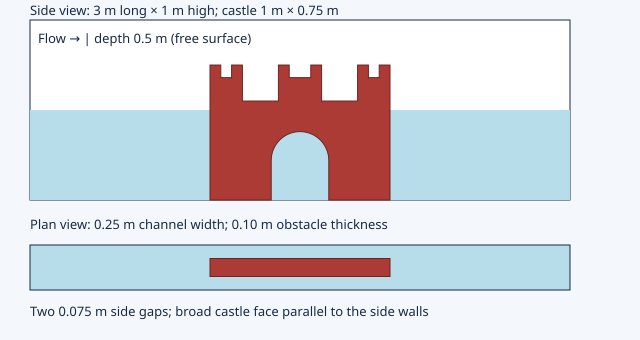
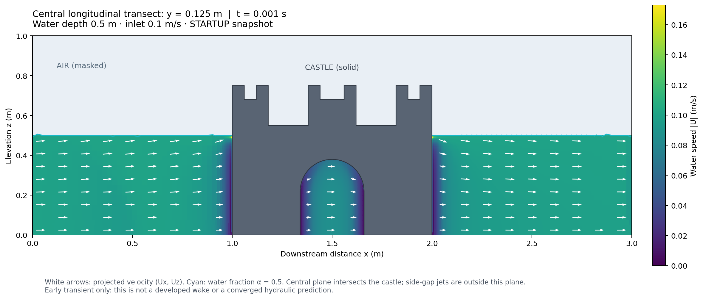

# Castle flume workbench preset

Use **Castle flume** in the desktop workbench (`python main.py`), or the CLI:

```bash
python -m pip install -r requirements-gui.txt
mkdir -p /tmp/castle-half
python castle_flume.py /tmp/castle-half --velocity 0.3 --depth 0.5
# Activate OpenCFD v1912 and build the custom solvers with ./Allwmake.
cd /tmp/castle-half
./Allmesh
sedimentInterFoam > log.sedimentInterFoam 2>&1
# ./Allrun meshes, initializes and runs the selected solver.
```

Generation requires an existing **empty** directory. All settings are validated
before staged files are moved into it. Use separate folders for different speeds,
depths and mesh studies. `flume.json` records inputs and the solver; `geometry.svg`
previews the geometry; `case.foam` opens results in ParaView.
The workbench **Mesh castle flume and check mesh** button runs `Allmesh` in its
monitored worker. Then use the execution tab's case/mesh checks and solver button.
Do not overwrite these dictionaries with the generic mesh generators. Configure
sediment through this preset before generation; the generic River Sediment writer
is disabled for the VOF solver because its single-phase fluid edits do not apply.



## Geometry

Coordinates are meters: x downstream, y cross-channel, z upward. Both presets
mesh the complete 3 × 0.25 × 1 m flume: x = 0–3, y = 0–0.25, z = 0–1.
The castle is centered at x = 1.5, y = 0.125 and mounted at z = 0. Its broad x–z
profile faces the side walls; its thickness is in y. Bounds are
(1, 2, 0.075, 0.175, 0, 0.75): **1 m long × 0.75 m high × 0.1 m thick**,
with two 0.075 m side gaps.

The closed, consistently oriented solid has three crenellated towers and a
central bed-open semicircular arch, passing through the y thickness. Arch span
is 0.32 m, spring elevation 0.22 m and crown elevation 0.38 m; the arc uses 32
segments. This is an idealized USACE-inspired castle, not an official logo tracing
or a calibrated model of a specific structure. No external CAD input is needed.

## Depth and flow

| Water depth | Solver | Surface treatment |
| --- | --- | --- |
| **0.5 m** | `sedimentInterFoam` | **Moving water–air VOF interface**, initially z = 0.5 m; 0.5 m air headspace and an atmosphere boundary at z = 1 m |
| **1 m** | `sedimentPimpleFoam` | Filled flume with a slip-wall lid at z = 1 m; 0.25 m water clearance above the castle |

Mean water inlet speed is continuously selectable from **0.1 to 1 m/s** in +x.
Both cases use RAS kOmegaSST, 5% water inlet turbulence intensity and length scale
0.07 times the open-channel hydraulic diameter. The bed, castle and side walls
are no-slip. The 1 m case uses zero outlet kinematic pressure with velocity
reversal handling. The 0.5 m case uses physical-pressure `p_rgh`, water/air
properties (1000/1 kg/m³, viscosity 1e-6/1.48e-5 m²/s), gravity and surface tension
0.072 N/m. See [VOF sediment model](sedimentInterFoam.md) for its equations.

`Allmesh` runs blockMesh, surfaceFeatureExtract, snappyHexMesh -overwrite, and
`checkMesh -allTopology -meshQuality`. It requires `Mesh OK.` and stops on failure.
For the 0.5 m case it then runs **setFields**: water below z = 0.5, air above,
water moving at the requested speed and air initially at rest. It also initializes
hydrostatic reduced pressure and the inlet's fixed water fraction profile.
Do not run a newly generated VOF case before this initialization.

The VOF inlet uses `variableHeightFlowRateInletVelocity`, with water discharge
Q = U × 0.25 × 0.5 m³/s and zero inlet water fraction above 0.5 m. The top admits
and releases air with atmospheric total pressure. Outlet pressure is a fixed
hydrostatic water/air profile for a 0.5 m tailwater; water fraction is advected out
with zero-water backflow. This outlet can reflect waves: assess a longer flume
or a damping region for wave-sensitive studies. Zero-gradient wall water fraction
implies neutral interface contact; contact-angle hysteresis is not modeled.
The interface in the flume evolves; it is **not a rigid lid at 0.5 m**.

## Sediment

Defaults: d50 = 0.125 mm, sediment density 2650 kg/m³, Ferguson–Church settling,
turbulent/molecular Schmidt numbers 0.7/1, Shields threshold 0.05 and erosion
exponent 1.5. Initial suspended concentration is zero; inlet water concentration
is 0.1 kg/m³; initial bed inventory is 1 kg/m². Only patch `bed` exchanges sediment.
Castle and side walls have zero normal sediment flux and no erodible inventory.
Air inflow and downstream backflow supply zero sediment.

CLI and GUI expose grain diameter, inlet concentration, bed inventory, erosion
rate and duration. **Erosion defaults to zero** until calibrated; settling and
deposition remain active. Set `--erosion-rate` to enable finite-inventory
excess-Shields exchange. In the VOF solver advection uses the bounded water-phase
flux, storage and diffusion are water-fraction weighted, and bed exchange is
weighted by the local wet fraction. A documented 1e-8 phase-capacity regularization
keeps dry-cell scalar equations nonsingular; its mass is included in budgets.

Both models use dilute, one-way sediment coupling on a fixed bed. They do not
predict bed deformation, scour-hole evolution, bedload, grain mixtures or
sediment feedback on the fluid. These are starting research cases, not calibrated
scour predictions.

## Mesh and numerical settings

Both presets use a 25 mm background grid: **120 × 10 × 40** cells, including air
in the shallow case. Retained point (0.2, 0.125, 0.25) is outside the castle.
Extracted edges and explicit feature snapping resolve crenellations and the arch.

| Region | Bounds (x; y; z), m | Level / nominal cell size |
| --- | --- | --- |
| Castle surface | full STL; wall patch `castle` | 2–3 / 6.25–3.125 mm |
| Obstacle vicinity | 0.95–2.05; 0.05–0.20; 0–0.8 | 2 / 6.25 mm |
| Arch | 1.30–1.70; 0.05–0.20; 0–0.42 | 3 / 3.125 mm |
| Bed | 0–3; 0–0.25; 0–0.05 | 2 / 6.25 mm |
| Left gap | 0.95–2.05; 0–0.075; 0–0.8 | 2 / 6.25 mm |
| Right gap | 0.95–2.05; 0.175–0.25; 0–0.8 | 2 / 6.25 mm |
| Wake | 2–2.8; 0–0.25; 0–0.85 | 2 / 6.25 mm |

Overlaps use the highest level. Each gap has at least about 12 cells across; castle
thickness has about 32 at level 3. Limits are 4 million global / 2 million local
cells and a 100-cell minimum refinement batch. No prism layers are generated.
Check y+ and conduct mesh/layer sensitivity studies; this is not a mesh-independence
claim. The free surface passes through the refined castle/wake region; far from
the obstacle its initial resolution is the background 25 mm.

Euler transport, upwind sediment advection, orthogonal sediment diffusion and two nonorthogonal pressure
corrections are used. The 0.5 m VOF case starts at dt = 0.0001 s, max dt = 0.001 s,
fluid Courant 0.4 and interface Courant 0.25. The filled case starts at 0.0001 s,
max dt = 0.002 s and fluid Courant 0.4. Both limit settling and use adaptive dt.
Scalar diffusion uses an uncorrected, positive matrix to avoid startup
undershoots; assess its error when increasing mesh non-orthogonality.
Default duration is 30 s, only one transit at 0.1 m/s; increase for stationarity.

## Validation workflow

Run `python -m pytest -q` for GUI, geometry and dictionary regression checks.
For actual v1912 meshing, interface/geometry probes and short sediment runs:

```bash
python tests/openfoam/validate_castle_flume.py --output /tmp/castle-validation --include-fast-shallow
```

The script generates fresh cases for 0.1 m/s at 0.5 m depth and 1 m/s at 1 m depth;
`--include-fast-shallow` adds the 1 m/s free-surface endpoint. It
checks arch/gap/wake connectivity and solid exclusion in the actual mesh, and
checks finite conservative sediment budgets. The shallow run must also retain
bounded water fraction and evolve its interface. A ~0.001 s smoke run is not a
developed wake, wave study or calibrated sediment result.

Acceptance uses `-allTopology -meshQuality` with explicit `system/meshQualityDict`
criteria matching snappy. The additional `-allGeometry` cell-convexity diagnostic
can flag nonconvex polyhedra despite positive volumes, valid face tets and passing
quality metrics; preserve and review it separately. Before quantitative use,
inspect the arch, side gaps and interface in ParaView, water/sediment mass balance,
y+, longer-time stability and reflection at the outlet, then compare finer meshes
and smaller time steps.

## Executed validation record (2026-10-17)

OpenCFD v1912 / patch 200626, double precision, 32-bit labels. The new VOF solver
was built against the matching upstream interFoam/VoF headers. The final VOF
binary, including its static-mesh/phase/Euler guards, passed the fast shallow run.
The full-height geometry mesh was reused across speeds; the top patch was changed
from slip wall to atmosphere for VOF and checked again.

- **53 Python tests passed**, including both depth presets, speed endpoints,
  closed/oriented STL and open arch, field/patch compatibility, no-overwrite
  behavior, GUI execution routing and rejection of uninitialized water fraction.
- Both top-boundary variants passed **checkMesh -allTopology -meshQuality**:
  **2,075,305 cells**, one connected fluid region, max non-orthogonality **35.46°**,
  max skewness **0.674**, minimum volume **1.229e-8 m³**, and zero explicit quality
  violations. Actual-mesh probes confirmed open arch, both side gaps, wake fluid,
  solid exclusion, and fluid/air clearance above the castle.
- The separate **-allGeometry** diagnostic reported **22,338 concave polyhedral
  cells** (one failed convexity check), while cell volumes, face tets, interpolation
  weights and other quality metrics passed. This diagnostic is recorded rather
  than described as passing. A fully convex mesh has not been established.

| Depth / inlet speed | Model | Completed steps / final time | Largest sediment budget residual |
| --- | --- | --- | --- |
| 0.5 m / 0.1 m/s | Moving water–air VOF | 2 / 0.001 s | 2.41e-16 kg |
| 0.5 m / 1 m/s | Moving water–air VOF | 2 / 0.000261972442 s | 6.43e-14 kg |
| 1 m / 1 m/s | Filled single-phase flume | 4 / 0.00103674037 s | 6.55e-14 kg |

All three runs completed with finite, nonnegative concentration. The shallow
saved interfaces changed from initialization by maximum |Δα| = **0.05709** and
**0.152352**, respectively; α stayed within [−1e-8, 1+1e-8]. Smoke tests used a
nonzero erosion coefficient of 1e-5 kg/m²/s and short durations; the slow shallow and filled
configurations capped dt at 0.0005 s. The slow shallow run used phase-solver
tolerance 1e-8; the final preset uses 1e-12, checked in the fast shallow run. Adaptive stepping accounts for final
times beyond the requested end. These tests establish execution, interface
movement and short-time conservation, **not** developed-flow accuracy or
long-time stability. Full logs and results remain under `/workspace/flume-validation`.

## Central longitudinal velocity visualization



This is the actual saved slow/shallow VOF result at **t = 0.001 s**, not a
schematic or developed wake. Color is three-dimensional water speed |U|; arrows
project (Ux, Uz) into the plane y = 0.125 m. Gray is the castle; air is masked;
cyan is the interpolated α = 0.5 contour. The central transect cuts through the
castle, so side-gap jets lie outside this plane. Peak central-plane water speed
in this snapshot is about **0.173 m/s**. Colors use the actual sliced mesh cells;
a regular sampling grid supplies the arrows and carries its own validity mask.

Recreate this view for any saved time:

```bash
python visualize_flume.py /path/to/case --output /tmp/central-velocity.png
# Optional: --time 1.0 selects an existing saved time instead of the latest.
```

The plotting command exports PNG, SVG and compressed NumPy data, including the
slice triangles, velocities, water fraction and sampled transect validity mask.
