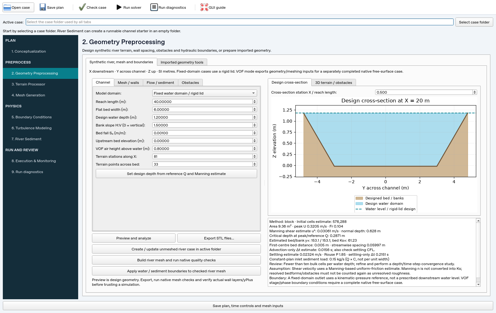

# Synthetic river design, meshing and boundaries

[GUI README](../GUI_README.md) · [Detailed GUI guide](gui-user-guide.md) ·
[Eulerian sediment](sedimentPimpleFoam.md) · [Sand parcels](sandParcelPimpleFoam.md)

Open **Geometry Preprocessing → Synthetic river, mesh and boundaries**. The
designer creates straight rectangular/trapezoidal channels, smooth raised
bedforms and separate solid obstacles. It previews **design geometry** and
reports hydraulic/mesh planning quantities. Use Run diagnostics for numerical
QAQC and ParaView for simulated fields.

## Create a case

1. Select an existing **empty folder** as the active case. Keep results outside
   the source checkout. Choose fixed water domain or water-plus-air VOF geometry.
2. Set channel length, flat-bed width, design depth, bank slope **H:V**, bed fall
   and upstream bed elevation. X is downstream, Y transverse, Z upward; all
   lengths are metres. Positive bed slope lowers bed elevation downstream.
3. Set bulk spacing, near-wall thickness, growth and roughness. Choose a RANS
   closure and flow/sediment plan. Add obstacles if required.
4. Click **Preview and analyze**. Read the review messages below the preview.
   The cross-section station control samples the designed terrain. The separate
   3D tab shows terrain/solids, not computed velocity or sediment output.
5. Click **Create / update unmeshed river case in active folder**. This writes
   the design, STL surfaces and native dictionaries. Inputs can be revised here
   until meshing begins. A folder with a mesh/results requires a fresh case.
6. Click **Build river mesh and run native quality checks**. Execution runs
   `blockMesh`, optionally `surfaceFeatureExtract` and `snappyHexMesh -overwrite`,
   then `checkMesh -allTopology -meshQuality`. The pipeline stops on failure or
   cancellation. Actual patch names/faces are checked before applying boundaries.
7. For fixed-domain cases, successful meshing automatically writes water,
   turbulence and sediment conditions. Run **Check case and mesh**, then a short
   one-rank run. Inspect solver warnings, wall layers, wall shear, measured
   `yPlus`, budgets and mesh/time-step sensitivity before a production run.

OpenFOAM tools must be available on the GUI execution machine. Native support
is **OpenCFD v1912**. The Python GUI does not install or remotely invoke them.
Partial/failed meshes remain available with their logs for investigation; create
a new case for redesign. The generic Boundary, Turbulence and River Sediment
editors remain available for deliberate later edits. Those edits do not change
the saved river-design plan; do not reapply that plan over intentional edits.



This preview shows specified geometry and planning estimates, not model output.

## Fixed water domain and VOF geometry

| Mode | Export and intended use |
| --- | --- |
| Fixed water domain | Full water cross-section, sloping rigid symmetry lid, runnable `sedimentPimpleFoam`, `sandParcelPimpleFoam` or water-only `pimpleFoam` starter with k–ω SST or k–ε RANS |
| Water + air / VOF | Terrain, closed meshing boundary including specified air freeboard, solid obstacles and block/snappy dictionaries; the top is an ordinary patch |

VOF mode deliberately exports **meshing inputs only**. Complete a native
free-surface case with `alpha.water`, `p_rgh`, gravity/phase properties,
initialization, schemes and physically appropriate stage/atmosphere/inlet
conditions before solving. The custom sediment solvers do not provide coupled
VOF, evolving bed elevation or flexible/porous vegetation physics. A fixed lid
cannot represent drawdown, waves or hydraulic jumps; the report flags near-critical
designs for review. Neither mode is a backwater/stage calculation.

## Terrain and obstacles

**Export STL files…** writes a portable geometry bundle to a selected folder:

| File | Meaning |
| --- | --- |
| `channel_terrain.stl` | Open bed and bank surface; useful as terrain, not a closed solid |
| `channel_boundary.stl` | Closed computational fluid boundary with named `bed`, `bankLeft`, `bankRight`, `inlet`, `outlet`, `lid` regions |
| `<obstacle>.stl` | Separate closed solid embedded into the bed; its fluid interface becomes a named wall patch |
| `river-geometry.json` | Reusable design parameters |

Case creation places STLs under `constant/triSurface`, and saves
`river-design.json` (parameters, estimates and readiness flags) and
`river-boundary-plan.json` (flow, design depth/level and pressure reference).
Reopening that case reloads the design controls. Backups use the same transactional
case writer as the other GUI editors. Export standalone STLs to a separate
folder if the active case must remain empty for case creation.

| Tool | Representation and dimensions |
| --- | --- |
| Pier / cylinder | Vertical rigid cylinder; width is diameter, height is above bed; length/yaw do not alter its circular shape |
| Rigid stems | Regular rows along X and columns along Y; width is stem diameter, spacing is centre-to-centre; each stem receives its own surface and wall patch |
| Boulder | Half-buried ellipsoid; length/width are horizontal axes, height above bed, yaw rotates the horizontal axes |
| Structure | Rectangular solid with length along local X, width along local Y, height above bed and yaw; useful for idealized groynes, low weirs and engineering obstructions |
| Bedform | Smooth compact raised terrain using a sin² profile in X and Y; length/width define its footprint and height its crest |

Bedforms taper to zero inside the flat bed and share its roughness/patch; set
their row Ks to zero. Their height is limited to 40% of design depth and their
footprint needs at least four terrain intervals per direction (eight or more
recommended). Increase terrain sample counts to represent curvature before
refining the volume mesh. These are fixed illustrative forms, not migrating dunes.

Solids must clear inlet/outlet by two background cells. Bank intersection needs
an explicit **Bank attached = true** flag; the solid must actually intersect the
water volume. The tool rejects complete box blockage, unsafe/duplicate patch
names, unresolved stems and conservatively overlapping solid footprints. Up to
100 stems per group and 150 expanded features are supported. Attachment does
not calculate structural scour, overtopping suitability or mesh connectivity;
inspect the generated surfaces and actual mesh. Banks/obstacles are impermeable
to Eulerian sediment and rebound parcels; only the bed starts as a depositional
surface. Change interactions deliberately for a different physical model.

## Mesh design and rough walls

Automatic mode uses a mapped, graded `blockMesh` channel for simple sections
with banks up to 2H:1V. Obstacles, bedforms and flatter banks use snappyHexMesh.
Explicit mapped mode rejects unsupported geometry.

Mapped meshes use exact-length vertical and mirrored lateral cell stacks.
**First cell / first layer thickness** is the whole cell thickness, so the
nominal first centre is half that distance. Lateral grading accounts for bank
inclination. Adjacent expansion is bounded by the chosen value in (1, 1.3];
explicit one-cell multi-grading avoids confusing adjacent expansion with total
block expansion. Streamwise spacing may be reduced below bulk spacing to
protect corner-cell quality; read the resulting cell estimate/budget. Very fine
first cells can make a mapped mesh expensive.

Snappy uses a padded isotropic background, explicit surface features, bed/bank
refinement, absolute-thickness wall layers and per-solid refinement. The target
solid spacing is its minimum relevant dimension divided by **Cells across
minimum solid dimension** (at least six; default ten). Refinement uses powers
of two and is checked against the maximum level. Wake boxes extend around and
downstream of each solid at one coarser level. Gap/outlet warnings suggest
additional resolution/domain length. The initial count is a background estimate;
it does not predict the final adaptive cell count or memory use.

Layer count and thickness are **requests**. Snappy may suppress layers near
corners, obstacles or narrow gaps. Read `snappyHexMesh` layer coverage/thickness
statistics and inspect the mesh; no guaranteed wall distance is inferred from
the requested settings. To fit the sloping lid correctly, snappy meshes it as
an unconstrained patch, then the workflow converts it to symmetry before QAQC.

The acceptance profile requires native topology checks, **one connected fluid
region**, and explicit `meshQualityDict` criteria, including max nonorthogonality
65°, max boundary/internal skewness 4, min face weight 0.05, min volume ratio
0.05 and positive-volume/tet criteria. Failures prevent automatic readiness.
The full dictionary is retained with the case. These thresholds support error
prevention; they are not an accuracy guarantee.

An additional audit is available from the terminal:

```bash
checkMesh -case /path/to/case -allTopology -allGeometry
```

Its extra convexity, face-flatness and cell-Jacobian diagnostics can flag cut
polyhedra and stretched layer cells even when the explicit acceptance profile
passes. Review those locations, refine/redesign and assess sensitivity. A
snappy profile pass must not be described as passing every extended audit.

Equivalent sand roughness **Ks [m]** and **Cs** configure
`nutkRoughWallFunction`; zero Ks selects a smooth wall function. The designer
uses supported RANS wall fields consistently. Manning n is independent of Ks:
it provides a uniform-friction planning estimate, never an automatic conversion.
Resolved bedforms, stems and structures must not also be counted as unresolved
texture roughness.

Planning calculations use `A = H(B + mH)`, hydraulic radius `R = A/P`, peak
`U = Q/A`, `Sf = (n U / R^(2/3))²`, `u* = sqrt(g R Sf)`,
`y+ = y u*/nu`, `Ks+ = Ks u*/nu`, and `Fr = U/sqrt(g A/T)`.
The normal-depth button solves Manning's uniform-flow equation at reference Q;
critical depth uses Fr = 1. These are not measured CFD shear/flow profiles.
Review low y+, Ks reaching the first-cell centre and layer-stack thickness.
For rough rivers, 300 is not a universal upper y+ limit; check wall-function
validity, effective roughness, measured y+ and resolution sensitivity.

## River inlet, outlet and sediment plan

Positive discharge is downstream. The inlet uses native `flowRateInletVelocity`
with Q in **m³/s**. The outlet fixes **kinematic pressure [m²/s²]**, with a
zero-velocity fallback for reverse flow. The boundary-plan JSON records a design
outlet water level for reference, but pressure zero is **not a prescribed stage**.
Inlet turbulence uses `k = 1.5 (U I)²` with the chosen intensity/length scale;
this uniform inlet needs sufficient development distance and sensitivity checks.

Water-only and Eulerian cases can import CSV:

```csv
time_s,Q_m3_s,C_kg_m3
0,3,0.05
50,5,0.08
100,3,0.04
```

Enable the table checkbox. Times must increase from zero through the run end,
Q/C must be nonnegative, and reversal is unsupported. Native Function1 tables
linearly interpolate Q and incoming Eulerian mass concentration. QAQC rejects a
later endTime beyond the saved table coverage. The reference Q remains useful
for the optional normal-depth button; peak table/reference Q screens mesh/CFL
requirements. Concentration is kg/m³, inventory kg/m², and total inlet sediment
load is **Q × C [kg/s]**, not a load per unit width.

Parcel starters use a constant Q × C feed only; hydrographs are rejected rather
than silently creating inconsistent injection. Choose uniform or Rouse feed,
computational parcels per second, and lower/upper feed heights as fractions of
depth. The initial strip covers 80% of flat-bed width. Rouse shear uses the
Manning planning estimate, not a resolved inlet shear measurement. Inspect
settling/Rouse assumptions and adjust in River Sediment as needed. Erosion and
parcel resuspension start disabled; they require deliberate physical calibration.

The exporter screens both advective and settling time scales and starts with
bounded adaptive time controls. Actual stability depends on the completed mesh,
updated flow and numerical schemes. The rebuilt Eulerian solver logs
**Sediment Courant Number** after flow correction, including settling, and closes
settling flux at symmetry/empty boundaries. Rebuild the C++ solver to receive
that fix and diagnostic; old executables do not change when the Python GUI updates.

Generated Eulerian cases use upwind concentration advection and
`grad(C) cellLimited Gauss linear 1` with corrected diffusion. Limiting the
concentration gradient reduces nonorthogonal-correction undershoots when sediment
first enters a clear channel near obstacles. It preserves equation-flux mass
accounting and does not clip C. Check fronts and spatial/time convergence;
limiting is not a positivity or accuracy guarantee for arbitrary meshes.

## Validation and reproducible checks

Python tests cover hydraulic identities, grading, manifold terrain, feature
validation, overwrite protection, boundary plans and GUI controls. Native checks
generate graded Eulerian/parcel channels, a pier, rigid stems, bedforms with a
boulder/bank structure, and VOF meshing inputs:

```bash
source /path/to/OpenFOAM-v1912/etc/bashrc
source .venv/bin/activate
./Allwmake
python -m pytest -q
python tests/openfoam/validate_river_design.py
python tests/openfoam/validate.py
```

Logs/cases are retained in a fresh temporary folder printed by each native
script. Checks include mesh topology/quality, discharge, Eulerian conservation,
zero rigid-lid settling flux, parcel injection mass and complete named patches.
Short integration runs demonstrate generated-case compatibility. They do not
validate river hydraulics, equilibrium sediment profiles, scour or transport
accuracy; those require appropriate data and mesh/time-step/physics studies.
