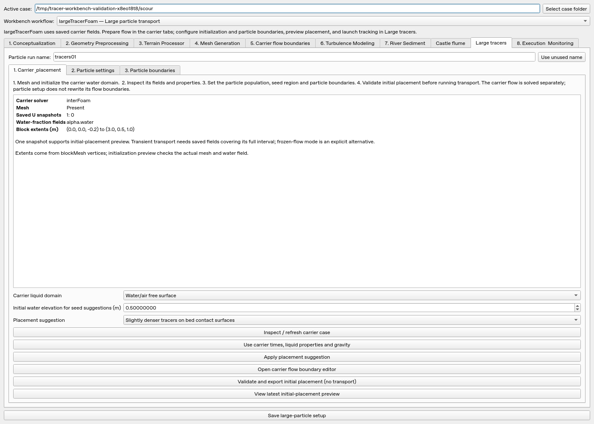
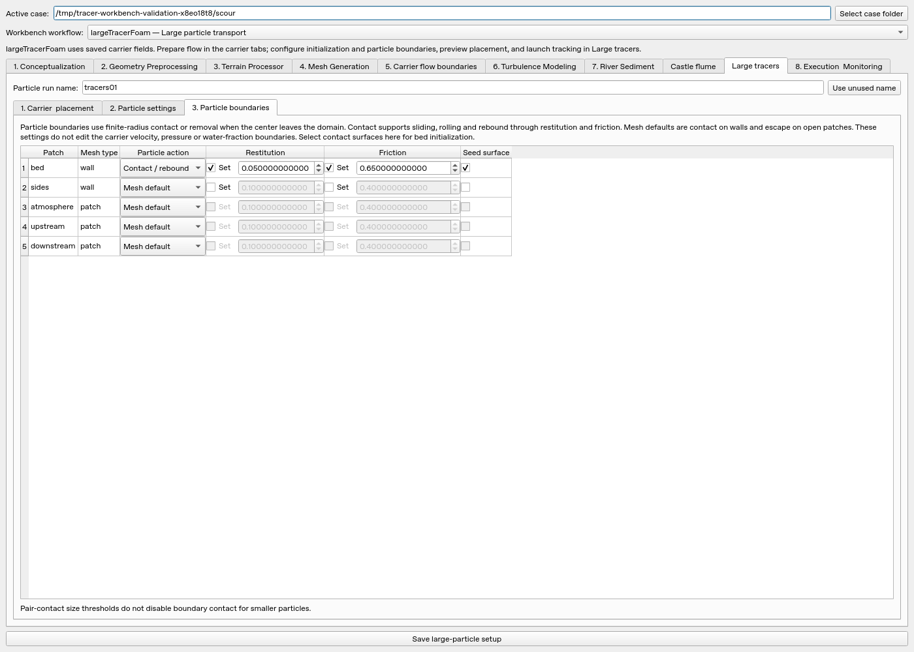

# Large-particle preprocessing and boundaries

The workbench has a dedicated **largeTracerFoam — Large particle transport**
workflow. It prepares individual physical spheres for tracking in saved flow.
Opening a case with `tracers.json` selects this workflow automatically.

The **Large tracers** tab separates three tasks: carrier/placement preprocessing,
particle settings, and particle boundaries. A particle run name remains visible
above these pages. **Use unused name** finds a free name for a new comparison.
Previous results are protected against overwriting.

## Carrier and placement

1. Select a carrier case, or generate the free-surface scour demo in an empty
   folder using the button in **Particle settings**. Mesh and initialize it;
   the demo's mesh button runs `blockMesh`, `checkMesh` and `setFields`.
2. Open **Carrier & placement** and inspect the case. The report shows its
   carrier application, mesh availability, saved velocity times, water-fraction
   fields, and available block extents.
3. Select **Water/air free surface** or **Filled single-phase liquid** to match
   the carrier. **Use carrier times, liquid properties and gravity** imports
   the saved time interval and available densities, dynamic viscosities and
   gravity vector. For a custom phase name, select its liquid-fraction field
   explicitly in Particle settings; the importer does not assume an air fraction
   represents water. Dynamic viscosity is calculated from the carrier's density
   and kinematic viscosity, μ=ρν. Named water/air properties are inferred;
   review and enter custom-phase material values manually before running.
4. Optionally apply a placement suggestion: buoyant volume tracers or slightly
   denser tracers on bed contact surfaces. The suggested seed box covers an
   inset portion of the wet domain. It does not infer a scour-hole region or
   rim: set those physical retention controls in **Particle settings**.



Case inspection is read-only. Extents are taken from literal `blockMeshDict`
vertices; they can include solid obstacles and dry space. For imported meshes
or dictionaries with generated vertices, enter the seed box manually. The native
initialization preview checks the actual mesh, wall clearance, water fraction
and particle overlaps, rather than trusting the bounding box.

The water elevation here assists seed-box suggestions. It does not initialize
or change the carrier's water level. Use the carrier setup/`setFields` workflow
for that. A 0.5 m scour-demo depth has water and air in the mesh and a moving VOF
surface; its particle setup uses `alpha.water`.

## Particle parameters

**Particle settings** contains the physical population and integration controls:

- Count (1–999), random seed, diameter and density distributions.
- Seed-center box, volume/bed placement, initial velocity, minimum initial water fraction.
- Scour retention box, rim elevation and displacement-based mobilization threshold.
- Transient or explicitly frozen carrier replay, start/end times and output interval.
- Water/air densities and dynamic viscosities, gravity, added mass, global contact coefficients.
- All-size or diameter-selected particle–particle sediment contact and quadrature resolution.

Bed seed surfaces are selected in **Particle boundaries**. The corresponding
names are displayed read-only on the settings page. Bed placement requires
gravity along negative z and contact surfaces intersected by a downward ray.

In particle workflow, **Save large-particle setup** writes only
`constant/largeTracerProperties` and `tracers.json`, with backups. It does not
change the carrier's `controlDict`, `U`, pressure, or water-fraction fields.
Switch to **Flow and sediment setup** when saving carrier time or solver changes.
The [solver guide](largeTracerFoam.md) describes the equations, units and limits.

## Particle boundary conditions

The **Particle boundaries** page imports actual mesh patches, including
compressed boundary metadata. Before meshing, it can use patch definitions in
`blockMeshDict`. Refresh the case after changing the mesh, and review any missing
saved patch names before writing settings.



| Setting | Effect on particles |
| --- | --- |
| Mesh default | Finite-radius contact on mesh walls; escape on supported open patches |
| Contact / rebound | Enforce finite-radius surface contact, using normal restitution and Coulomb friction; rotation/rolling follows the contact impulse |
| Escape | Remove a particle when its center leaves the mesh; no contact constraint on that patch |
| Restitution / friction **Set** | Override that coefficient for this patch; unchecked coefficients independently inherit the global value |
| Seed surface | Include this contact surface in downward-ray bed initialization |

The particle rules are independent of carrier boundary-field types. For example,
an open fluid outlet can have particle contact to retain bodies at a screen,
while fluid continues to use its original outflow condition. A wall patch can
instead remove particles with an escape rule. This remains one-way tracking;
the carrier does not resolve a new screen or particle-driven obstruction.
Escape occurs at center crossing, consistent with other domain exits.

Contact is available to every particle size. The large-particle pair cutoff
affects only particle–particle contact, not particle–boundary contact. The
editor provides contact and removal, without adding artificial permanent bed
sticking or changing the noncohesive sediment mechanics.

For a native case:

```foam
particleBoundaries
{
    bed        { type contact; restitution 0.05; friction 0.65; }
    sides      { type contact; friction 0.3; }
    downstream { type escape; }
}
```

Unspecified patches retain mesh defaults, so old cases behave as before. The
same rules appear in JSON under `boundaries`, with `behavior`, `restitution`
and `friction` fields. Null coefficients inherit globally. Unknown patches,
invalid coefficients and escape surfaces selected for bed seeding are rejected.

The **Open carrier flow boundary editor** button opens the separate velocity,
pressure and phase-fraction editor. In particle workflow its tab is labeled
**Carrier flow boundaries** to distinguish those equations from particle rules.

## Preview before transport

**Validate and export initial placement (no transport)** invokes the actual
native seeding algorithm. It checks that all requested particles can be placed
inside the mesh with radius clearance, sufficient sampled water fraction, and
no initial overlap. An infeasible population fails before particle output is
created.

The preview needs initialized `U` and the selected water-fraction field at the
start time. If the start lies between snapshots, it interpolates those fields.
A single initialized snapshot is sufficient when it matches the start time.
It does not require the future carrier solution and does not advance particles.

Results are isolated in `postProcessing/largeTracers/<runName>-preview`, with
numeric suffixes for repeated previews. Its `previewOnly true` settings marker
identifies an initialization result. **View latest initial-placement preview**
opens its plot/replay. Initial x–z and x–y figures and the interactive plane
selector show the population; `particles.pvd` supports viewing it in ParaView
alongside the carrier geometry.

```bash
largeTracerFoam -case /path/to/case -preview
python3 visualize_tracers.py /path/to/case/postProcessing/largeTracers/tracers01-preview --carrier --show
```

After reviewing placement, run the carrier solver and save flow fields across
the desired interval, then run particles from **Particle settings**. Full
transient replay still requires at least two saved times covering start to end.
The GUI refuses incomplete coverage instead of silently freezing or extrapolating
the flow. Frozen-flow tracking remains an explicit choice.

See the [recorded workbench validation](validation/tracer-workbench/README.md)
for native boundary references and the real GUI-to-initialization check.
