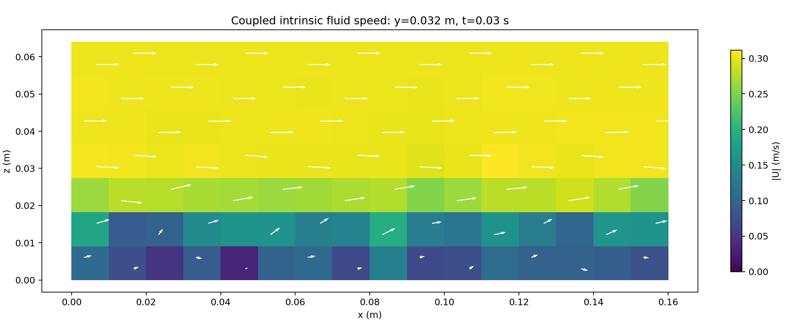
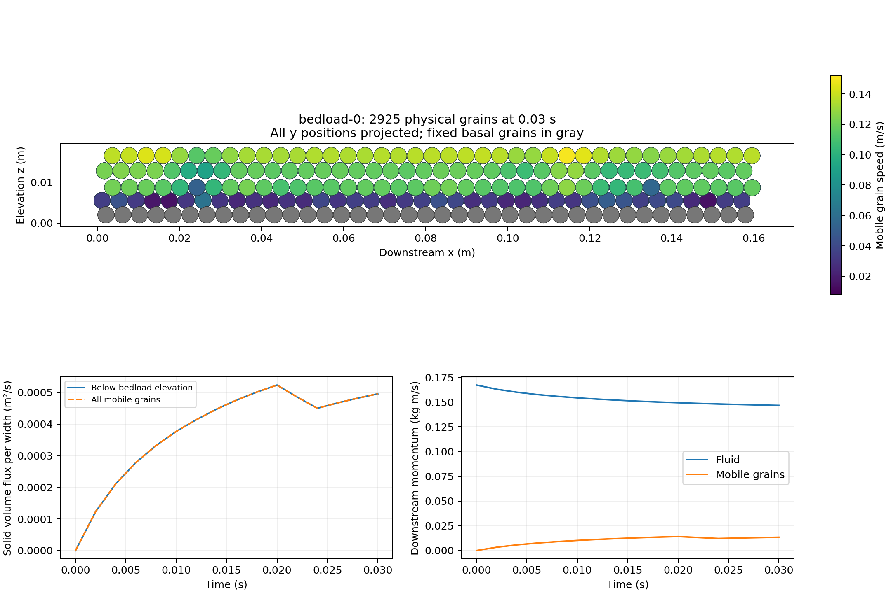

# CFD–DEM validation, 19 October 2026

These are measured results from the new `bedloadDemPimpleFoam` executable,
not synthetic particle paths or a prescribed bedload relation. The native
reference suite passed all **13 groups**, the Python suite passed **138 tests**,
and the existing workbench's five native workflow groups passed.
See the [solver guide](../../bedloadDemPimpleFoam.md) for equations and limits.

## Reproduce

The tested installation used OpenCFD v1912, double precision, 32-bit labels,
GCC 14, and a serial shared LAMMPS GRANULAR library from
`stable_22Jul2025_update4`. The source archive SHA-256 is
`411088d9c03339e025f6a975e0a5741bb9e3f351cc39eda220ab22ac318fe2fb`.
The optional backend helper pins and verifies this archive.

After activating OpenFOAM and building with `./Allwmake --with-dem`:

```bash
QT_QPA_PLATFORM=offscreen pytest -q
python tests/openfoam/validate_dem.py
QT_QPA_PLATFORM=offscreen python tests/openfoam/validate_gui.py

# Use a new empty directory. The generated Allrun protects existing results.
python bedload_dem.py /absolute/empty/bedload-demo --diameter .004 --end-time .03
/absolute/empty/bedload-demo/Allrun
python visualize_dem.py \
  /absolute/empty/bedload-demo/postProcessing/bedloadDEM/bedload-0 --flow
```

The original native case and trajectories remain in the execution workspace at
`/workspace/bedload-dem-demo-final`. It was subsequently resumed to 0.0302 s to
exercise dense-bed contact/rolling restart and an unscheduled final write. The
archived plots, budget and demonstration metrics below describe the original
**0–0.03 s** segment. Full meshes, binary dependencies and all time directories
are intentionally outside the source repository.

## Component references

| Check | Measured result | Acceptance |
| --- | --- | --- |
| Unforced periodic fluid + grain momentum | Relative error 5.20 × 10⁻¹⁵ | <10⁻⁷ |
| Two mobile grains, normal Hertz restitution | 0.8000223 | Target 0.8 ± 0.015 |
| Mobile grain against frozen roughness | Restitution 0.8000341 | Target 0.8 ± 0.02 |
| Serial restart, maximum grain-state difference | 5.55 × 10⁻¹⁷ | <10⁻⁸ |
| Two-rank restart vs serial reference | Maximum grain-state difference 1.39 × 10⁻¹⁶ | <10⁻⁷ |
| Active frictional-contact restart | Position 3.66 × 10⁻¹⁰ m; velocity 2.03 × 10⁻⁷ m/s; spin 2.51 × 10⁻⁴ rad/s | <10⁻⁸ m; <10⁻⁵ m/s; <10⁻³ rad/s |
| Coupling-step refinement, fixed DEM accuracy | Fine/medium state-difference ratio 0.635 | Between 0 and 0.8 |

The maximum state-difference figures combine positions, velocities and spin
components for implementation regression; they are not a nondimensional
physical error norm. The separate active-contact tolerances have physical units.
LAMMPS recomputes velocity-dependent contact forces after restart, so these
contacts are not expected to be bitwise identical to uninterrupted integration.
The refinement test uses CFD steps 4 × 10⁻⁵, 2 × 10⁻⁵ and 10⁻⁵ s and maximum
DEM step 5 × 10⁻⁷ s. This is evidence of decreasing temporal error in that
reference, not a complete mesh/DEM-step convergence study.

The suite additionally checks conservative grain volume and drag impulse, a
reacting fluid, positive solid flux, the empty-cloud limit, periodic image flags,
frictional spin, porosity-weighted laminar/RANS/LES selection, final-time output,
and refusal of overpacked or incomplete restart cases. The two-rank checks use
distributed fluid mapping with one shared, master-owned serial DEM engine.

## Four-millimetre bed demonstration

The 0.16 × 0.064 × 0.064 m periodic channel contains **2,925 physical grains**:
2,340 mobile and 585 frozen basal grains, all 4 mm diameter and 2,650 kg/m³.
The fluid starts at 0.3 m/s with k–ω SST and downstream acceleration 0.1 m/s².
There are 16 × 7 × 7 fluid cells, a 3-grain-radius mapping kernel with 128
quadrature points per grain, CFD steps up to 10⁻⁴ s, and DEM substeps up to
2 × 10⁻⁶ s. Contact properties and all generator settings are archived.

| Quantity | Result |
| --- | --- |
| Completed time and CFD steps | 0.03 s; 300 steps |
| Particle mass change | 0 kg |
| Total physical grain mass | 0.2597468806 kg |
| Liquid volume | 5.573423092 × 10⁻⁴ m³ |
| Minimum mapped porosity over the run | 0.447150 |
| Maximum drag-impulse mismatch over the run | 7.59 × 10⁻¹⁹ kg·m/s |
| Maximum volume-averaged absolute continuity residual | 1.05 × 10⁻¹⁰ s⁻¹ |
| Largest grain-pair overlap at the final saved frame | 0.237% of diameter |
| Instantaneous downstream bedload flux at 0.03 s | 4.95431 × 10⁻⁴ m²/s |

The final-frame overlap uses all particle pairs with periodic minimum-image
distances in x and y. It is not the maximum over the entire simulation.
The bed is settling from an imposed layered arrangement and the fluid is
developing; the reported flux is an instantaneous spatial average. The effective
100 MPa grain stiffness is softened for the demonstration. These results do not
establish equilibrium transport, entrainment thresholds, or experimental accuracy.

The flow image uses the saved OpenFOAM **intrinsic fluid velocity** at y=0.032 m.
Colors show its three-dimensional speed; arrows show its x–z components. Cells
are displayed at their actual resolution. Particle positions in the second
image are projected from all y positions, rather than implying a single grain
layer at the transect.





## Archived files

- `native-validation.log`, `component-results.json`: the 13 native check groups.
- `python-validation.log`: the Python regression suite.
- `existing-workbench-validation.log`: existing GUI-to-OpenFOAM workflow checks.
- `demonstration-settings.json`, `demCouplingProperties`: case/contact settings.
- `demonstration-results.json`, `demonstration-budget.csv`: measured diagnostics.
- `demonstration-restart.log`, `demonstration-lammps-restart.log`: the additional
  0.03–0.0302 s dense-bed restart, including contact-history recovery diagnostics.
