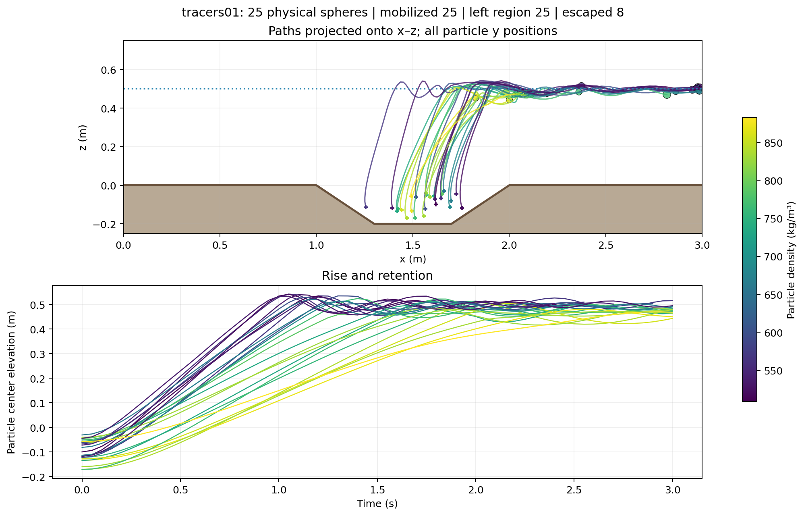
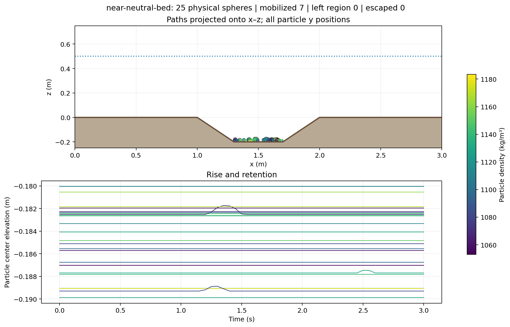
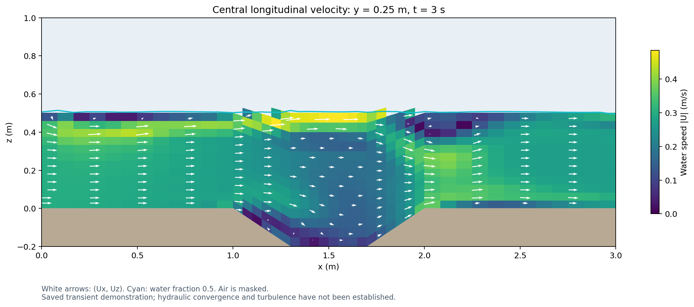

# Large tracer validation — 18 October 2026

The later [diameter-cutoff validation](diameter-cutoff/README.md) covers the
large-particle-only sediment-contact mode and the expanded regression suite.

The tested implementation is `largeTracerFoam` on OpenFOAM.com v1912,
double precision with 32-bit labels, built with GCC 14 in the prepared Linux
environment. `./Allwmake` completed for all four repository solvers. These checks validate the implemented mechanics and replay
workflow. They do not establish predictive accuracy for a particular tracer
material or turbulent scour experiment.

## Reference mechanics

`python3 tests/openfoam/validate_large_tracers.py` passed all 15 check groups.
It creates independent manufactured carrier fields and invokes the actual
C++ executable. See [raw results](physics-results.json) and the
[check transcript](native-validation.txt).

| Reference problem | Measured result |
| --- | --- |
| Neutral sphere advected at 0.2 m/s for 0.3 s | Position error 1.72 × 10⁻¹⁵ m |
| Low-Re Stokes response, including added mass | Relative velocity error 2.04 × 10⁻⁵ |
| Buoyant rise, d=0.03 m, ρp=700 kg/m³, Cd=0.44 | Relative difference from asymptotic terminal speed 0.00258 at 0.7 s |
| Neutral sphere in uniformly accelerating transient flow | Velocity error 3.33 × 10⁻⁷ m/s |
| Timestep refinement, 0.002 → 0.0005 s | Acceleration-case velocity error reduced to 0.2485 of the coarse-step error |
| Initially half-submerged sphere, ρp=500 kg/m³ | Mean sampled water fraction 0.499440; hydrostatic balance predicts 0.499399 |

The static floating check uses 512 sphere samples, a 0.01 m vertical mesh and
a 0.1 m diameter sphere. It tests equilibrium, rather than water-entry impact
or a validated free-surface oscillation period. The low-Re drag comparison
has a small Schiller–Naumann correction relative to the Stokes reference.
The terminal-rise comparison is made at finite time, not at infinite time.

Additional passing groups check finite-radius bed contact, rolling/spin,
nonoverlapping placement on a sloping wall, elastic pair momentum and energy,
region exit and computational escape, atomic rejection of impossible or
overlapping initialization, rejection of transient extrapolation, repeatable
size/density populations, protection against output overwrite, and 999 distinct
physical particles. PVD/VTK results were also read with PyVista, including a
snapshot with zero active particles and a 999-particle snapshot.

The Python/Qt regression suite passed **85 tests**. The replay JavaScript passed
syntax and control smoke checks with a simulated DOM in Node (time selection,
retention counts, particle selection, plane selection and color selection).
The generated PNGs were visually inspected.

## Scour-hole demonstration

The carrier case was generated with:

```bash
python3 scour_tracer_demo.py /path/to/case --end-time 3 --coarse
cd /path/to/case
./Allmesh
interFoam > log.interFoam 2>&1
largeTracerFoam > log.largeTracerFoam 2>&1
```

Geometry: 3 m long, 0.5 m wide, fixed 0.2 m depression, water initially 0.5 m
above the rim, air to z=1 m. The inlet is 0.3 m/s. `interFoam` models the moving
water/air interface. The outlet permits flow and surface-level adjustment.
The demonstration is laminar and transient; it has no sediment erosion or
particle feedback on the carrier.

The 6,336-cell block mesh passed `checkMesh`: maximum non-orthogonality 33.14°,
maximum skewness 0.4913, and positive cell volumes. Flow fields were saved every
0.1 s through 3 s. Particle output is every 0.05 s, maximum substep 0.002 s,
with 128 volume samples per sphere. The buoyant run used 1,976 substeps; the
bed run used 1,500.

At 3 s the maximum saved water-cell speed is approximately 0.4853 m/s.
Discrete water volume changes from approximately 0.82149 to 0.82836 m³ during
the startup flow. This is an open system with changing storage; no integrated
boundary-flux water-balance validation was performed. See
[carrier metrics](carrier-metrics.json). The coarse interface and near-bed
velocity field have not undergone spatial or snapshot-spacing convergence
studies. Refinement is required before quantitative physical interpretation.

### Buoyant volume-seeded spheres

25 spheres, uniform diameters 20–40 mm, uniform densities 500–950 kg/m³,
initial velocity zero, seed 42. All centers start inside the depression.
The [recorded settings](buoyant-settings.foam), [events](particle-events.csv),
and [per-object summary](particle-summary.csv) accompany the plots.

At 3 s: **25 mobilized, 25 left the depression, 25 crossed the rim, 8 escaped
the domain, and none remained in the retention box**. Buoyancy contributes
directly to their release; these outcomes do not measure a bed-shear threshold.



[Interactive replay](replay.html) · [Outcome counts](outcomes.json)

### Slightly denser spheres placed on the bed

The same saved flow was replayed with 25 spheres, diameters 20–40 mm and
densities 1050–1200 kg/m³, initially at rest on the depression's floor.
Use [near-neutral-settings.json](../../../tutorials/largeTracerScour/near-neutral-settings.json)
to repeat it. The native [settings snapshot](bed-settings.foam),
[events](near-neutral-bed/events.csv), and [summary](near-neutral-bed/summary.csv)
are retained.

At 3 s: **7 mobilized and all 25 remained in the depression**. No sphere crossed
the rim or escaped the domain. Mobilization means displacement of at least one
own diameter, so it can include local rolling while retained in the hole.



[Interactive bed-particle replay](near-neutral-bed/replay.html) ·
[Outcome counts](near-neutral-bed/outcomes.json)

### Central longitudinal carrier velocity

This is the actual saved velocity at y=0.25 m, t=3 s. Colors show speed;
arrows show its x–z projection. Air is masked and cyan marks water fraction
0.5. Particle trajectories above project all particle y positions and should
not be read as a central-plane particle slice.



After both particle runs, **278 carrier-field and mesh files** were compared
against the original carrier case and were unchanged; see
[integrity check](field-integrity.json). This permits direct comparisons
between populations without recomputing flow.

The particles are unresolved spheres with approximate drag, buoyancy, added
mass and contact. Large blockage or high local volume fraction needs a coupled
model. Floating/contact behavior, turbulence, real shape and bed roughness
need validation for the intended experiment. See the
[model guide](../../largeTracerFoam.md#limits-and-validation) for specific omissions.
