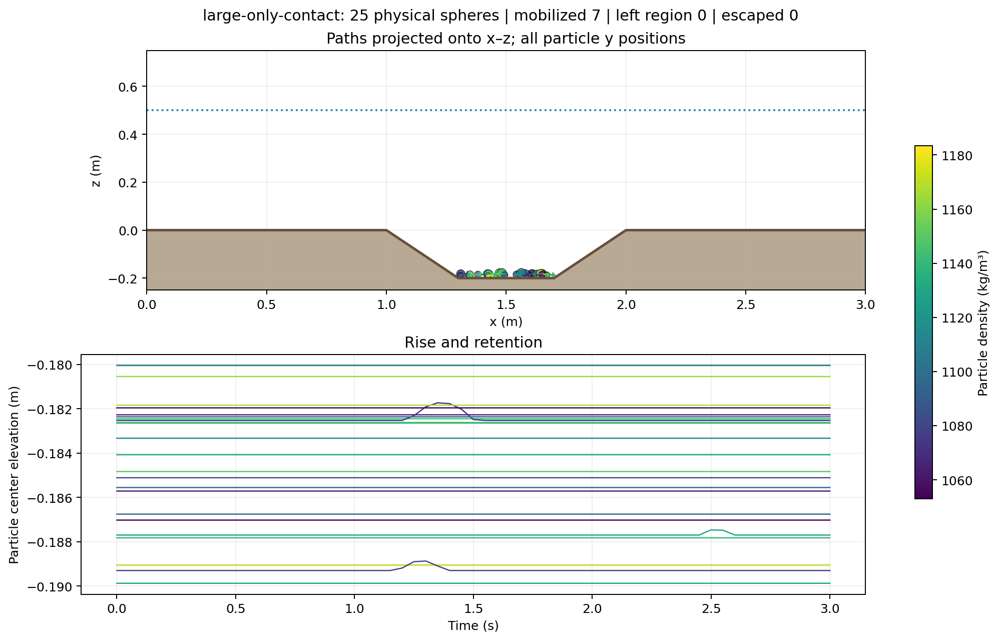

# Diameter cutoff for sediment contact

Validated on OpenFOAM.com v1912, double precision with 32-bit labels. All four
repository solvers built with `./Allwmake`. The Python/Qt regression suite
passed **94 tests**. The native tracer suite passed **21 check groups**, including
the original mechanics tests and the new cutoff/contact checks.

The mode reuses the existing noncohesive sediment contact model: inelastic
normal collision, Coulomb tangential friction, and the resulting rotational
motion. The feature selects which particle pairs receive these interactions.
It retains the carrier-flow and wall-contact equations.

## Selection and mechanics checks

Run `python3 tests/openfoam/validate_large_tracers.py` after activating OpenFOAM.
The script invokes the compiled solver on manufactured carrier fields, with
negligible fluid drag for isolated impact references. See the
[results](results.json) and [transcript](native-validation.txt).

| Check | Verified behavior |
| --- | --- |
| Both diameters above cutoff | Eligible spheres collide and remain separated |
| Diameter exactly equal to cutoff | Pair excluded; no impulse or overlap correction |
| Both diameters below cutoff | Pair excluded; trajectories can cross |
| One large and one small sphere | Pair excluded even though one sphere exceeds cutoff |
| `all` and disabled modes | Original all-size behavior and master switch preserved |
| Native/JSON settings without new entries | Original all-size or disabled behavior preserved |
| High-precision cutoff snapshot | Archived cutoff retains its value near the diameter boundary |
| Invalid mode or nonpositive cutoff | Rejected before any particle output is created |
| Particle below cutoff falling onto the bed | Gravity/fluid response and finite-radius wall contact retained |

For the mixed 100 mm / 40 mm pair with a 60 mm cutoff, initial x velocities
are +0.2 and −0.2 m/s. Threshold mode retains those velocities as the particles
cross. All-size elastic contact produces approximately +0.151880 and
+0.551880 m/s, matching the independent unequal-mass collision equations.

For equal-mass head-on contact with restitution e=0.3, the final kinetic energy
is **0.08999999996** of the initial energy, matching e²=0.09. Linear momentum
is conserved in the isolated reference.

Oblique impact checks include both friction regimes, with translation and
rotation included in the energy calculation:

| Regime | Friction coefficient | Measured tangential/normal impulse ratio | Final/initial kinetic energy |
| --- | --- | --- | --- |
| Sticking contact | 0.4 | 0.121914, below the Coulomb limit | 0.236894 |
| Sliding contact | 0.05 | 0.050000, at the Coulomb limit | 0.260286 |

Both cases recover normal restitution 0.3, conserve linear momentum, dissipate
energy, and generate spin consistent with the tangential contact impulse.
The sticking case removes contact slip; the sliding case retains slip.
These checks validate the numerical contact laws, rather than material-specific
wet restitution, lubrication or grain roughness.

## Mixed-size scour replay

The existing 0.3 m/s water/air scour carrier was replayed for 3 s using
[large-particle-contact-settings.json](../../../../tutorials/largeTracerScour/large-particle-contact-settings.json).
The population has 25 bed-seeded spheres, 20–40 mm diameters, densities
1050–1200 kg/m³, and a **30 mm** pair-contact cutoff. The full-height carrier
mesh includes the moving free surface above its initial 0.5 m water depth.

**14 particles qualified for pair contact and 11 were excluded.** Seven particles
mobilized by at least one own diameter. All 25 remained in the depression;
none crossed the rim or escaped. The eligibility flag agreed with `d > 0.03`
in the native summary and VTK snapshots. All **278 carrier-field and mesh
files were unchanged**, checked by SHA-256 before and after replay.

The outcome counts demonstrate the workflow; the two-body reference cases
above establish the contact-selection behavior. The scour carrier is the same
coarse, laminar startup demonstration described in the
[original validation](../README.md#scour-hole-demonstration), without a new
hydraulic convergence or material calibration claim.

[Interactive replay](replay.html) · [Summary](summary.csv) · [Events](events.csv) ·
[Native settings](largeTracerProperties) · [Counts](outcomes.json) ·
[Integrity and eligibility checks](scour-checks.json)

The replay's **Pair contact eligibility** color mode distinguishes selected
objects, and clicking a particle shows its eligibility. This describes its
size/configuration class, rather than an active impact. Older CSV outputs
remain viewable without the new eligibility field. New VTK output exposes
`pair_contact_eligible` for coloring in ParaView.
