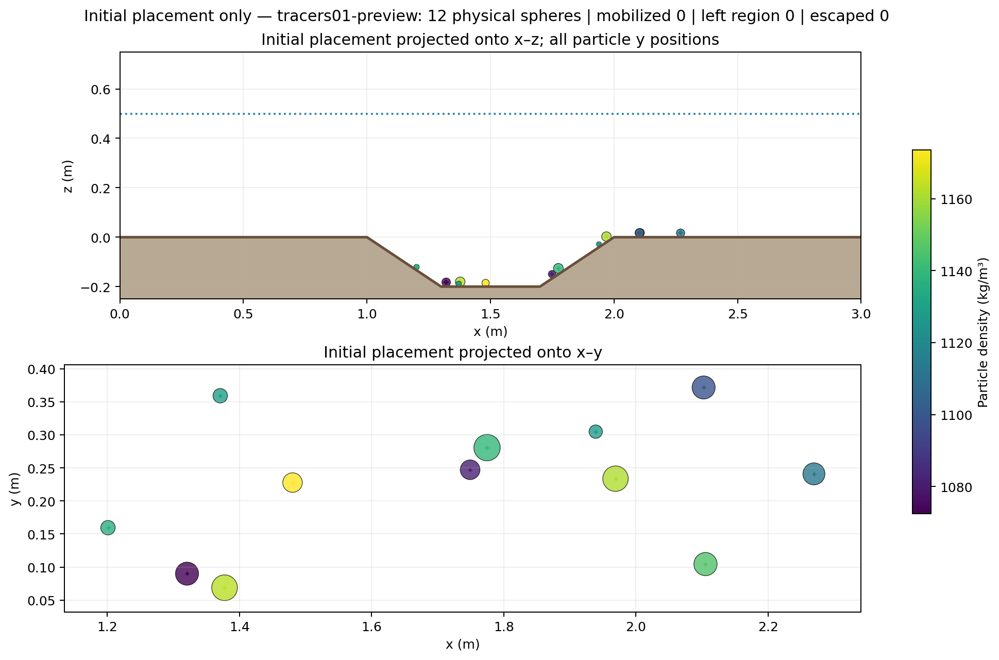

# Specialized tracer workbench validation

Validated on OpenFOAM.com v1912, double precision with 32-bit labels. All four
repository solvers build with `./Allwmake`. The Python/Qt regression suite passes
**106 tests**, and the native tracer suite passes **25 check groups**.

## Particle boundaries and initialization

`tests/openfoam/validate_large_tracers.py` includes the previous particle-force,
diameter-cutoff and collision checks, plus these native references:

- A fluid outlet configured for particle contact retains a 0.1 m sphere one
  radius inside the boundary. Its outgoing normal speed matches the patch
  restitution of 0.5, independently of the global restitution value.
- A mesh wall configured for escape removes a particle at center crossing.
- A frictionless bed override preserves tangential speed and produces no spin,
  while its zero restitution removes incoming normal velocity.
- Unknown patches, invalid actions and coefficients, and contact coefficients
  on escape rules fail before output creation.
- A one-snapshot initialization preview exports each initial sphere exactly
  once, without advancing velocity or position. Repeated previews get separate
  directories, and the original flow fields remain unchanged.
- A preview between two saved times interpolates velocity at its start while
  permitting the requested future transport interval to remain unsolved.
- Full transient tracking still rejects missing future flow data. Preview
  metadata is set by the executable's actual mode, including when archived
  preview settings are used as input for a normal run.

See the [native transcript](native-validation.txt). These checks validate the
implemented contact and initialization behavior, rather than a particular
sediment material's calibration.

## Real workbench-to-solver workflow

Run after activating OpenFOAM:

```bash
QT_QPA_PLATFORM=offscreen python3 tests/openfoam/validate_tracer_workbench.py
```

This test creates a fresh coarse scour case with water/air VOF at an initial
0.5 m water depth. It uses the real Qt workbench and command worker to mesh,
check and initialize the carrier, inspect properties, choose bed placement,
write particle boundary overrides, and run `largeTracerFoam -preview`.

The GUI selects 12 spheres and bed coefficients e=0.05, μ=0.65. It then saves
particle setup after editing the general carrier time widget. The test verifies
that the actual carrier `controlDict` remains unchanged, with application
`interFoam`. The native preview contains **12 initial states at t=0 and zero
transport steps**. SHA-256 comparisons confirm that all **8 initialized carrier
field/mesh files** remain unchanged. These files are the case's initial fields
and generated mesh, not the separate particle dictionaries/results.

The GUI refuses a full transient particle run because only initialized time 0
exists; it does not convert that run to a frozen carrier. See
[results](results.json), [GUI transcript](gui-validation.txt),
[preview settings](preview-settings.foam), and [per-object preview summary](preview-summary.csv).




[Interactive initial-placement preview](initial-placement.html)

The screenshots and specialized pages were checked with Qt's offscreen platform.
The existing OpenGL mesh viewport could not create a context there; its 3D
rendering was not part of this validation. The native mesh/field calculations
and particle preview were executed and verified.

The existing [GUI-to-OpenFOAM workflows](legacy-gui-validation.txt) also pass:
Eulerian and sand-parcel setup, boundary writing, solver execution and restart,
two-rank resuspension/restart/reconstruction, generated meshing dictionaries,
and custom-mesh flow-boundary rebuilding. This checks that the new particle
workflow does not replace the existing flow and sediment workflow.
